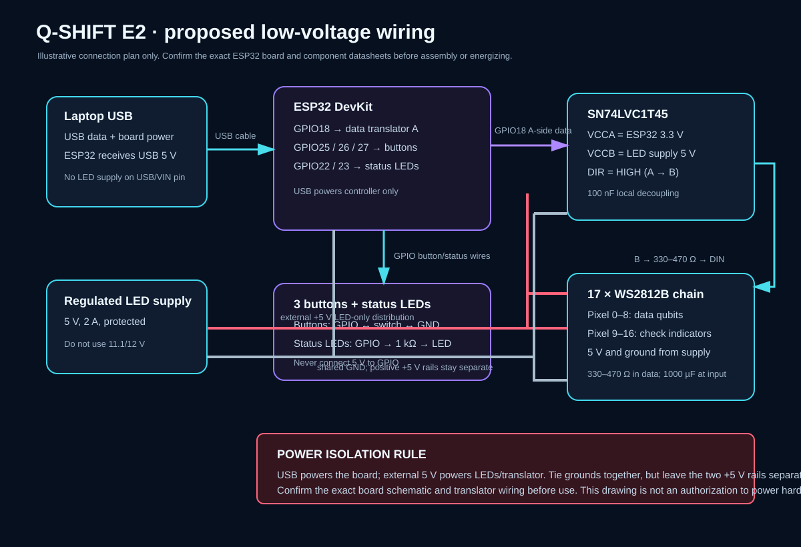

# Q-SHIFT exhibition board — construction and safety guide (E2)

This is a proposed low-voltage wiring plan for the 25 × 18 cm model. It is not a passed electrical safety review and is not permission to energize or connect hardware. The exact ESP32 board and exact LED part number have not been inspected. Confirm both before buying/building and before any power test.



## Board profile and pin map

The supplied firmware build profile targets a **classic ESP32-WROOM-32 DevKit V1 (`esp32dev`) only**. It deliberately refuses an unselected board profile. Do not use it for ESP32-S2/S3/C3 or a WROVER board without a separate pin/power review. Read the module marking and board schematic; “ESP32 DevKit” alone does not identify the variant.

| ESP32-WROOM-32 GPIO | Connection | Notes |
|---:|---|---|
| 18 | 5 V-side level-shifter input A | WS2812B data; translator output B goes through 330–470 Ω to first DIN. |
| 25 | Inject Error button to GND | `INPUT_PULLUP`, active low, 50 ms debounce. |
| 26 | Decode button to GND | `INPUT_PULLUP`, active low, 50 ms debounce. |
| 27 | Reset button to GND | `INPUT_PULLUP`, active low, 50 ms debounce. |
| 22 | Green status LED through 1 kΩ to GND | Connected steady; brief double flash when Decode completes. |
| 23 | Red status LED through 1 kΩ to GND | Nonblocking blink while disconnected; brief pulses on protocol errors. |
| 3V3 | Translator VCCA and DIR | A-side is 3.3 V; DIR high selects A→B. |
| GND | Common reference | ESP32, translator, buttons, LED supply, and strip ground share ground. |

The pins are a reviewed candidate for the named WROOM-32 DevKit profile: the official DevKitC guide exposes GPIO18/22/23/25/26/27 and identifies flash-reserved pins and WROVER-specific pin differences. Reconfirm the exact board's own pinout before construction. [Espressif ESP32-DevKitC guide](https://documentation.espressif.com/esp-dev-kits/en/latest/esp32/esp32-devkitc/user_guide.html)

## Power plan

Use a regulated, protected **5.0 V, 2 A** external supply for the LED chain and the translator's 5 V rail. The laptop USB cable powers the ESP32 board. Tie grounds together, but **do not join the external LED +5 V rail to ESP32 5V/VIN**. This separates the positive rails and avoids relying on unknown board USB/external-supply isolation. The guide for Espressif's specific DevKitC V4 lists USB, 5V/GND header, and 3V3/GND as mutually exclusive board supply choices; other clones may differ. [Espressif DevKitC power guidance](https://documentation.espressif.com/esp-dev-kits/en/latest/esp32/esp32-devkitc/user_guide.html)

For the data signal, use a genuine **SN74LVC1T45** dual-rail translator: VCCA=ESP32 3.3 V, VCCB=LED 5 V, DIR=HIGH from VCCA, A=GPIO18, B=series resistor→DIN. TI specifies partial-power-down Ioff and VCC isolation for this part, including high-impedance ports if either supply is at ground; still use the exact-device datasheet and verify breakout pin labels. Add a 100 nF ceramic decoupler at the translator and a 10 kΩ pulldown from strip DIN to LED ground. The data line must never apply 5 V to an ESP32 GPIO. [TI SN74LVC1T45 product data](https://www.ti.com/product/SN74LVC1T45)

Place a 330–470 Ω resistor close to the first LED DIN and a correctly polarized 1000 µF capacitor (at least 6.3 V rating) across LED +5 V/GND at the chain input. Connect the strip's 5 V and ground directly to the supply distribution; do not route LED current through the ESP32 board or a solderless breadboard. Use short, suitably rated power wires and strain relief.

### Current calculation

Use the conservative common WS2812 RGB design bound of 60 mA per pixel at full white until the exact purchased LED datasheet provides a verified lower bound:

`17 pixels × 60 mA/pixel = 1,020 mA at 5 V` (about 5.1 W).

A regulated 2 A, 5 V supply provides margin for the chain and wiring. Firmware limits pixel brightness to 48/255, which suggests roughly 192 mA at full white if current scales linearly; this is only an operating estimate and **must not** be used to undersize the supply. The WS2812B family has variants with different electrical details; use the exact part data sheet. The Worldsemi WS2812B-2020 datasheet specifies a 3.7–5.3 V supply range and 12 mA per color channel for that particular package variant. [Worldsemi WS2812B-2020 datasheet](https://xonstorage.z8.web.core.windows.net/pdf/worldsemi_ws2812b2020_apr22_xonlink.pdf)

### USB and external supply coexistence

The proposed topology lets USB power the ESP32 while a separate supply powers LEDs and translator VCCB because their **positive rails remain separate** and only ground is common. This is not a statement that an unidentified DevKit safely accepts USB and external 5 V on its board power input simultaneously. Do not connect the LED supply's positive lead to the ESP32 5V/VIN pin while USB is connected. The dual-rail translator reduces signal-path back-power risk when either domain is off, provided it is the specified part and wired as shown. Disconnect both supplies before wiring changes. Do not use 11.1 V or 12 V on the strip or ESP32 GPIO.

## Bill of materials

| Qty | Item | Specification / use |
|---:|---|---|
| 1 | ESP32 DevKit | Confirm exact ESP32-WROOM-32 module and board revision before using the provided profile. |
| 1 | WS2812B chain/PCB | 17 individually addressable 5 V RGB pixels, with accessible DIN/DO and power pads. |
| 1 | Regulated supply | Protected 5.0 V, 2 A supply, suitable enclosure/strain relief. |
| 1 | USB data cable | Correct connector for board, data-capable (not charge-only). |
| 1 | SN74LVC1T45 | Genuine dual-rail translator or reviewed breakout; 3.3 V A side to 5 V B side. |
| 1 | 100 nF ceramic capacitor | Translator local decoupling. |
| 1 | 330–470 Ω resistor | Series with LED data, at first pixel DIN. |
| 1 | 10 kΩ resistor | DIN pulldown to LED ground. |
| 1 | 1000 µF electrolytic capacitor | ≥6.3 V, across LED supply at chain input; verify polarity. |
| 3 | Momentary push buttons | Normally open; GPIO-to-GND, internal pull-up enabled. |
| 2 | Indicator LEDs + 2 × 1 kΩ resistors | Green link and red fault/disconnected indicators. |
| — | Wiring and board materials | Common-ground distribution, insulated wire, 25 × 18 cm panel, diffuser, standoffs, strain relief. |

No current supplier prices were checked. Confirm the total against the ₹2,000–₹3,000 target using the exact local parts before purchase.

## Unpowered assembly sequence

1. Confirm board marking/revision, LED datasheet and supply label. Stop if the board is not the WROOM-32 profile or LED rail requirements differ.
2. Lay out the 9 data indicators in E1 row-major order and the 8 check indicators in E1 order. Label every LED index before soldering.
3. Wire the three normally-open buttons from GPIO25/26/27 to GND. Do not connect a button to 5 V.
4. Assemble the translator and its 100 nF capacitor. Wire GPIO18 to A, VCCA to 3V3, VCCB to the LED-only 5 V rail, DIR to 3V3, B through 330–470 Ω to DIN, and pulldown DIN to LED GND.
5. Wire the green/red status LEDs only through their 1 kΩ resistors to GPIO22/23 and GND.
6. Wire LED supply +5 V/GND to the chain power pads, capacitor in correct polarity, and common ground to the ESP32. Keep external +5 V disconnected from ESP32 5V/VIN.
7. With all supplies disconnected, inspect continuity, polarity, shorts, resistor placement, and connector strain relief. Have the separate wiring and power review performed before the first power-up.
8. Only after explicit approval and that review may a person follow the approved power-on/firmware procedure. No hardware was energized, connected, or flashed in E2.

## LED behavior

| Condition | Data indicators | Eight check indicators | Separate status indicators |
|---|---|---|---|
| Idle | Dim blue | Dim violet | Green off; red blinks until host state arrives. |
| Known simulated fault | Selected input LED amber | Current frame | Link indicators as below; amber means known demo input, not decoder inference. |
| Valid detector event | No inferred data correction shown | Magenta | — |
| Valid check, no event | — | Dim cyan | — |
| Check unavailable at that boundary | — | Dim amber, distinct from zero | — |
| Decoded | Known input stays amber | Same detector frame | Green double-flash acknowledges Decode step; no per-qubit correction display. |
| Disconnected | Freeze last verified frame | Freeze last verified frame | Green off, red 1 Hz blink; local button presses are dropped. |

## Build and verification

After confirming the exact board is the classic ESP32-WROOM-32 DevKit profile, install PlatformIO Core in the user's development environment and build from this directory:

```powershell
cd exhibition-demo\firmware\phase_e2
pio run -e esp32dev_e1_profile
```

This downloads the pinned ESP32 platform/framework and two libraries if missing. Do not run `pio run -t upload`: firmware flashing requires separate authorization. The current Codex environment did not have `pio`, `platformio`, or `arduino-cli`; therefore this source has **not** been compiled here. Use only the deterministic host tests in this phase. No actual ESP32/LED test was performed.
