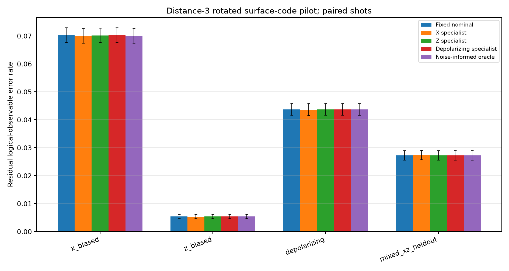

# Q-SHIFT Phase 3A — Surface-Code Pilot Report

## Abstract

This bounded pilot changed the Q-SHIFT test geometry from a distance-3 repetition memory to Stim's rotated distance-3 Z-memory surface code. Three independent seeds generated paired detector shots under X-biased, Z-biased, depolarizing, and held-out mixed X/Z circuit-level Pauli noise. The ideal circuit and fault opportunities were held constant while the Pauli composition changed. PyMatching specialists occasionally changed corrections, unlike in the Phase 1 repetition-code experiment, but the most favorable effect was only 8 fewer residual errors over 36,000 X-biased test shots, from 2,528 to 2,520. Those eight net errors came from 12 changed corrections and were consistent in direction across three seeds, but too few to establish a robust advantage. **Pilot decision: inconclusive.**

## Research question and motivation

Does changing code geometry make composition-specific PyMatching models change decisions and reduce logical-observable failures? Phase 1 recognized noise regimes but did not show guarded adaptive improvement. Phase 2 found identical corrections from X-, Z-, and depolarizing-specialist matchers on every tested repetition-code sample, and a validation oracle chose fixed matching every time. This Phase 3A pilot tests whether surface-code geometry creates a more useful opportunity. It does not build or evaluate an adaptive selector.

## Geometry and circuit

The circuit is Stim `surface_code:rotated_memory_z`, distance 3, three syndrome rounds. It has 9 data qubits and 8 stabilizer ancillas (four X-type and four Z-type checks), or 17 active physical qubits. Stim indexes qubits through index 25, so `num_qubits=26` includes unused index gaps. The circuit has 24 detectors and one logical observable, `L0`. The encoded logical `|0_L>` is initialized, stabilizers are measured through the rounds, and terminal logical Z is measured. `L0` represents an observable flip relative to the ideal memory circuit. It is a decoder target for scoring, not an input; predicting it does not mean every physical qubit has been recovered.

The no-noise generated circuit sampled 256 shots with all detector and logical-observable bits zero. Each noisy circuit compiled, sampled, generated a Stim DEM, built a PyMatching decoder, and returned the expected one-bit prediction for each shot. Validation array shapes are saved in the results JSON.

## Controlled noise conditions

Stim's generated circuit supplies post-Clifford `DEPOLARIZE1/2(0.01)` fault locations. For this controlled comparison, each such location was transformed into independent single-qubit `PAULI_CHANNEL_1(pX,pY,pZ)` channels on the same participating qubits. The total nonidentity probability is `pX+pY+pZ=0.01` per participating-qubit location in every condition:

| Condition | Conditional composition `(X,Y,Z)` | Actual `(pX,pY,pZ)` |
|---|---:|---:|
| X-biased | (0.8, 0.1, 0.1) | (0.008, 0.001, 0.001) |
| Z-biased | (0.1, 0.1, 0.8) | (0.001, 0.001, 0.008) |
| Depolarizing | (1/3, 1/3, 1/3) | (0.00333, 0.00333, 0.00333) |
| Held-out mixed X/Z | (0.5, 0, 0.5) | (0.005, 0, 0.005) |

All four conditions have the same circuit, 18 post-Clifford channel instructions, and 168 qubit-participant fault opportunities per shot. Those opportunities include data and stabilizer ancillas; this is not a data-qubit-only noise experiment. Measurement flips are disabled (`p_measure=0`), so no measurement-fault opportunities are included. This keeps composition comparisons at equal local nonidentity probability and equal opportunity count. See [config.json](config.json) for the executable settings.

## Decoder models

- **Fixed nominal:** PyMatching from the depolarizing p=.01 circuit DEM.
- **X, Z, and depolarizing specialists:** PyMatching from their corresponding composition model at p=.01.
- **Noise-informed oracle:** the model matching the known simulated test composition; reference only.

All models receive exactly the same detector matrix for a condition and seed. The residual bit is sampled `L0 XOR predicted observable`. No sampled observable labels are decoder inputs. DEM export uses Stim `decompose_errors=True, approximate_disjoint_errors=True`; this approximation is necessary for matching conversion of the local Pauli model. Model DEM hashes, sizes, edge counts, and matcher metadata are in the JSON. The Python wrapper size is not total native memory usage.

## Pilot method

The reported run (`v4`) used three independent seeds and 12,000 shots per condition per seed: 144,000 paired shots total. Every model was scored on each shared detector set. Results include raw `L0` flips, residual errors, correction disagreements, paired error differences, approximate paired 95% intervals, exact paired McNemar p-values, per-seed comparisons, and batched runtime. The script verifies a shared cross-condition circuit structure hash, ignoring only channel arguments. This is an exploratory pilot; small counts and multiple comparisons limit inference. No test results were used to tune weights.

### Aggregate results

Counts are out of 36,000 shots per condition (3 seeds × 12,000). Paired difference is candidate residual errors minus fixed residual errors. Disagreement counts compare predicted corrections to fixed.

| Test condition | Raw flips | Fixed errors | X specialist errors (Δ; disagreements) | Z specialist errors (Δ; disagreements) | Depolarizing errors | Oracle errors |
|---|---:|---:|---:|---:|---:|---:|
| X-biased | 7,007 | 2,528 | 2,520 (−8; 12) | 2,527 (−1; 1) | 2,528 (0; 0) | 2,520 |
| Z-biased | 1,877 | 194 | 193 (−1; 1) | 194 (0; 0) | 194 (0; 0) | 194 |
| Depolarizing | 5,390 | 1,573 | 1,571 (−2; 6) | 1,573 (0; 0) | 1,573 (0; 0) | 1,573 |
| Mixed X/Z held out | 4,243 | 982 | 983 (+1; 1) | 982 (0; 0) | 982 (0; 0) | 982 |

The strongest apparent difference is X-specialist on X-biased noise: candidate-only-wrong=2, fixed-only-wrong=10, paired exact p=0.0386, approximate paired rate-difference interval [−0.0411%, −0.0034%]. The estimated reduction is 0.0222 percentage points. The comparison has only 12 discordant shots. If one applies a simple 12-comparison Bonferroni correction over three specialists and four conditions, its adjusted p is about 0.463. It is not confirmatory evidence. For the other X-specialist conditions, the paired exact p-values are 1.0, 0.6875, and 1.0 respectively. The oracle exactly matched the X specialist on X-biased test shots and otherwise tied fixed; it showed no meaningful extra advantage.

### Per-seed paired error differences

Entries are candidate minus fixed residual-error counts; a negative value favors the candidate. The last four columns are X, Z, depolarizing specialists, and oracle.

| Condition | Seed | X | Z | Depolarizing | Oracle |
|---|---:|---:|---:|---:|---:|
| X-biased | 31503001 | −2 | −1 | 0 | −2 |
| X-biased | 31503002 | −4 | 0 | 0 | −4 |
| X-biased | 31503003 | −2 | 0 | 0 | −2 |
| Z-biased | 31503001 | 0 | 0 | 0 | 0 |
| Z-biased | 31503002 | 0 | 0 | 0 | 0 |
| Z-biased | 31503003 | −1 | 0 | 0 | 0 |
| Depolarizing | 31503001 | 0 | 0 | 0 | 0 |
| Depolarizing | 31503002 | −1 | 0 | 0 | 0 |
| Depolarizing | 31503003 | −1 | 0 | 0 | 0 |
| Mixed X/Z | 31503001 | 0 | 0 | 0 | 0 |
| Mixed X/Z | 31503002 | 0 | 0 | 0 | 0 |
| Mixed X/Z | 31503003 | +1 | 0 | 0 | 0 |

The X-specialist reduction under X-biased noise has the same direction in all three seeds, but the absolute improvement is just 2–4 errors per seed. Most specialists still produce identical corrections to fixed matching in most conditions. No adaptive selection is justified by this pilot.

## Runtime, memory, and graph

On this Python 3.12.10 / Stim 1.16.0 / PyMatching 2.4.0 / NumPy 2.5.3 environment, batched decoding measured about 0.41–0.44 microseconds per shot depending on model. These are local batch throughput timings, not per-shot hardware latency. Each DEM has 75 matching edges. The DEM text is approximately 3.4–6.0 KB; `sys.getsizeof` reports a 48-byte Python wrapper and omits native graph memory. These memory measurements are therefore incomplete. See [the result JSON](results/phase3a_surface_pilot_v3.json) for model-by-model values.

## Pilot decision

**Inconclusive.** The geometry does create non-identical matching decisions: X specialist changes 12 of 36,000 corrections under X-biased noise, with 8 fewer residual failures and a favorable direction in all three seeds. Other conditions show at most six X-specialist disagreements, while Z and depolarizing specialists mostly tie fixed. The pilot is too small in informative disagreements to decide whether this is a repeatable, useful advantage; the unadjusted p-value is not robust to the comparison family. This is not a claim that the selector/adaptive Q-SHIFT works.

## Limitations and Phase 3B recommendation

- Only one distance, one memory orientation, three rounds, and three seeds were studied.
- The pilot uses one circuit-level local Pauli channel convention and no measurement noise, leakage, correlated faults, or hardware data.
- Stim DEM decomposition approximates disjoint Pauli error mechanisms.
- X-specialist changed very few decisions; confidence intervals based on so few discordant shots are unstable. Three seeds do not support strong seed-level inference.
- The oracle knows the true simulated condition and is only a reference. No detector-only composition selector was built.
- Runtime is batched software throughput; Python wrapper size omits native memory.
- Observable prediction is not a physical recovery of all qubits; no hardware integration is claimed.

For Phase 3B, first replicate the X-biased condition with more independent seeds and enough paired shots to accumulate substantially more than 12 correction disagreements, while retaining the same four-condition cross-evaluation and predeclared paired analysis. Confirm the probability convention and DEM behavior on a small validation run before scaling. If the X-specialist advantage does not replicate with practical effect size and multiplicity-aware evidence, stop specialist-selection work. If it does replicate, only then evaluate a causal detector-based selector on separate data, including an unfamiliar-mixture fixed-model fallback. This report ends at the Phase 3A pilot; no larger run was performed.

## Reproducibility and artifacts

From this directory, run `python run_phase3_pilot.py --output <new_unique_result_name>.json`. The script saves raw arrays after each seed and refuses to overwrite artifacts with an existing stem. Results, seed arrays, and SHA-256 manifest are included. The initial erroneous v1 run is retained and excluded; v2 and v3 corrected checkpoints are also preserved. Phase 1 and Phase 2 artifacts were not edited.
