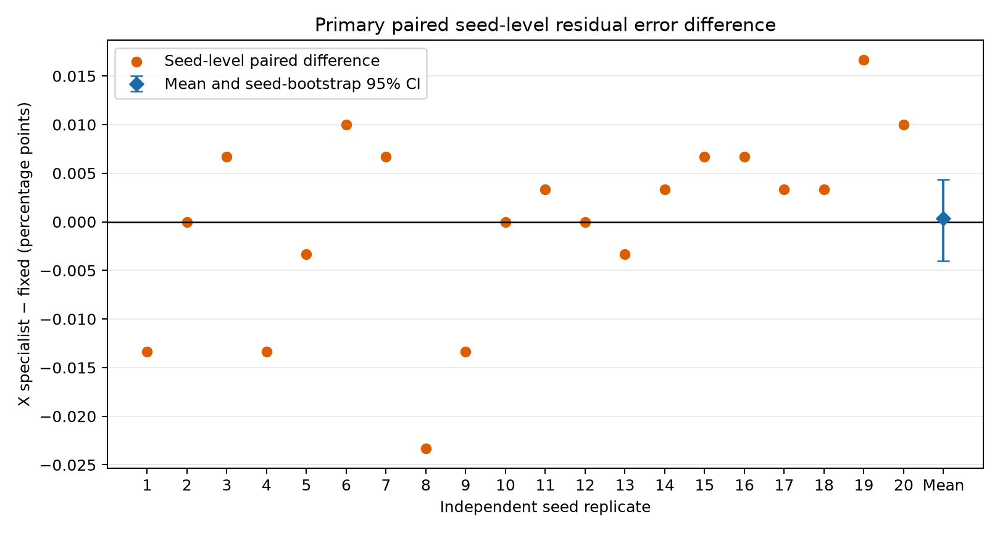
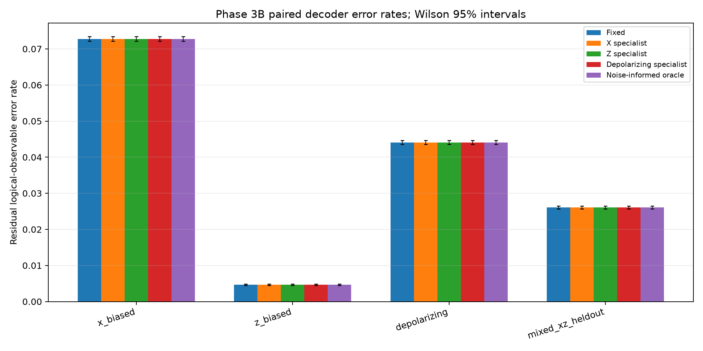

# Q-SHIFT Phase 3B — Independent Replication Report

## 1. Research question

Does the X-specialist PyMatching decoder reproducibly reduce residual logical-observable errors compared with fixed nominal PyMatching under X-biased noise on the existing distance-3 rotated surface-code Z-memory circuit?

## 2. Motivation from Phase 3A

Phase 3A reported 2,528 fixed errors and 2,520 X-specialist errors in 36,000 X-biased shots, an apparent reduction of eight errors and 12 changed predictions. The three pilot seed differences were −2, −4, and −2. Its corrected multiple-comparison p-value was approximately 0.463. This was an interesting but inconclusive pilot finding and motivated the frozen independent replication.

The audit found Phase 3A v1 used conditional composition fractions as unconditional channel probabilities. Its approximately 50% residual rates are invalid and excluded. Corrected v2, v3, and v4 are successive checkpoints over the same three seed bundles: each corresponding raw NPZ has the same SHA-256 across all three versions. They are not independent experiments. The exact Phase 3A corrected implementation is retained by importing the audited runner; its source and v4 result hashes are pinned in Phase 3B configuration and checked before data generation.

## 3. Experimental protocol

The frozen protocol's SHA-256 is `eb052d2679937a8a9b2e291f03af1347ceb46e4a6acbcaf8f3526b47b52517a0`. The runner SHA-256 was frozen in `CONFIG.json` before the test and is verified at startup. The primary endpoint is the paired seed-level residual rate difference, X specialist minus fixed; negative favors X specialist. The pre-registered primary analysis uses a two-sided exact sign test over independent seed differences at alpha=.05 and a 95% percentile bootstrap CI for the mean difference from 100,000 seed resamples. A reproducible improvement requires both sign-test p<.05 and the seed CI entirely below zero. Pooled paired McNemar is reported as supporting shot-level analysis, not independent replication evidence.

No test result was used to tune weights, choose a model, or stop early. Raw detector samples were generated once per seed and condition and passed identically to each decoder. `L0` is used only after prediction to compute residual error.

## 4. Circuit and noise model

The circuit is Stim `surface_code:rotated_memory_z`, distance 3, 3 rounds, with 9 data qubits, 8 stabilizer ancillas (4 X checks and 4 Z checks), 24 detectors, and one logical observable. Stim's index range results in `num_qubits=26`, with 17 active qubits. The encoded logical `|0_L>` is initialized and protected while stabilizers are measured; terminal logical-Z parity defines `L0` relative to the ideal circuit. The ideal 256-shot check produced zero detectors and zero observable flips in all shots.

The frozen conditions keep p=.01 total local nonidentity probability:

| Condition | Conditional composition (X,Y,Z) | Applied channel probabilities (pX,pY,pZ) |
|---|---:|---:|
| X-biased (primary) | (0.8, 0.1, 0.1) | (0.008, 0.001, 0.001) |
| Z-biased | (0.1, 0.1, 0.8) | (0.001, 0.001, 0.008) |
| Depolarizing | (1/3, 1/3, 1/3) | (0.00333, 0.00333, 0.00333) |
| Held-out mixed X/Z | (0.5, 0, 0.5) | (0.005, 0, 0.005) |

As in Phase 3A, Stim's post-Clifford `DEPOLARIZE1/2(0.01)` instructions are replaced by independent `PAULI_CHANNEL_1` channels on participating qubits. There are 18 channel instructions and 168 participating-qubit fault opportunities per shot, including data and ancilla participants. This is not a correlated two-qubit gate-noise model. Measurement flip probability is zero. All conditions share an identical circuit structure and detector/observable definitions. DEM conversion uses `decompose_errors=True, approximate_disjoint_errors=True`, which approximates decomposition of disjoint Pauli mechanisms into graphlike errors.

## 5. Decoder descriptions

- **Fixed nominal:** PyMatching from the depolarizing p=.01 DEM.
- **X specialist:** PyMatching from the X-biased p=.01 DEM; this is the primary candidate.
- **Z specialist and depolarizing specialist:** retained Phase 3A models for secondary exploratory cross-evaluation.
- **Noise-informed oracle:** the matching model for the true simulated condition. It receives hidden condition identity and is an upper-reference only, not a deployable decoder.

All decoders output an estimated logical-observable correction from detector bits. Residual error is sampled `L0 XOR predicted correction`. Predicting an observable does not physically recover every qubit.

## 6. Independent seeds and shot design

The study used 20 seed roots from 31604001 through 31794001 in increments of 10,000. Each root generated four unique condition seeds using offsets 101, 201, 301, and 401. None overlap Phase 3A seeds or the separate timing check seed 31999001. Each root is treated as the independent replicate; the four condition datasets under one root do not count as four seeds.

Each seed-condition dataset contains 30,000 paired shots, for 600,000 primary X-biased shots and 2.4 million shots total. Phase 3A's 12/36,000 prediction-disagreement rate suggested approximately 10 informative corrections per seed at this shot count. A separate non-test timing check found about 0.029 seconds to decode 30,000 shots with both primary models. The full fixed test size was chosen before results were read; the protocol had no outcome-based stopping rule.

## 7. Primary results

| Measure | Fixed nominal | X specialist |
|---|---:|---:|
| Test shots | 600,000 | 600,000 |
| Residual logical-observable errors | 43,673 | 43,675 |
| Residual error rate | 7.27883% | 7.27917% |

The paired difference was **+2 errors**, or **+0.000333 percentage points** for X specialist minus fixed; positive favors fixed. Relative to fixed's residual count, this is a +0.00458% change. The specialist made 162 different corrections: 82 were specialist-only wrong and 80 were fixed-only wrong. The pooled exact McNemar p-value was 0.9374; approximate paired 95% interval for the rate difference was [−0.00382, +0.00449] percentage points.

## 8. Seed-level analysis

| Seed root | Fixed errors | X-specialist errors | Difference (X − fixed) |
|---:|---:|---:|---:|
| 31604001 | 2,168 | 2,164 | −4 |
| 31614001 | 2,193 | 2,193 | 0 |
| 31624001 | 2,209 | 2,211 | +2 |
| 31634001 | 2,168 | 2,164 | −4 |
| 31644001 | 2,185 | 2,184 | −1 |
| 31654001 | 2,222 | 2,225 | +3 |
| 31664001 | 2,150 | 2,152 | +2 |
| 31674001 | 2,241 | 2,234 | −7 |
| 31684001 | 2,159 | 2,155 | −4 |
| 31694001 | 2,160 | 2,160 | 0 |
| 31704001 | 2,214 | 2,215 | +1 |
| 31714001 | 2,163 | 2,163 | 0 |
| 31724001 | 2,154 | 2,153 | −1 |
| 31734001 | 2,231 | 2,232 | +1 |
| 31744001 | 2,168 | 2,170 | +2 |
| 31754001 | 2,196 | 2,198 | +2 |
| 31764001 | 2,169 | 2,170 | +1 |
| 31774001 | 2,090 | 2,091 | +1 |
| 31784001 | 2,257 | 2,262 | +5 |
| 31794001 | 2,176 | 2,179 | +3 |

The X specialist favored fixed on **6 seeds**, fixed matching favored on **11**, and **3 tied**. Mean seed-level rate difference was +0.00000333 (X specialist slightly worse); median was +0.0000333. The 95% bootstrap CI for the mean was [−0.0000400, +0.0000433] as a rate difference, or [−0.00400, +0.00433] percentage points. The exact two-sided seed sign-test p-value was 0.3323. The primary criterion for reproducible improvement was not met.

## 9. Paired shot-level analysis

There were 82 shots where only the X specialist failed and 80 where only fixed matching failed. This near balance yields exact paired McNemar p=0.9374. The 162 prediction disagreements represent 0.027% of paired shots. This analysis treats shots as paired observations within seed and is supplementary; the seed-level test is the main generalization analysis.

## 10. Secondary exploratory comparisons

All secondary tests are corrected with Holm's method over the pre-registered 15 contrasts, separately for seed sign tests and pooled McNemar tests. No comparison was significant after correction (all adjusted p-values ≥0.981 for the pooled paired tests and ≥1.0 for the seed sign tests).

The Z specialist made 11 different corrections from fixed on X-biased data and had seven fewer errors, but its pooled raw p=.0654 and Holm p=.981; only three seeds favored it, with no adjusted evidence. The X specialist made 86 changed predictions on depolarizing data with two more errors, and 52 changed predictions on held-out mixed X/Z with two more errors. The fixed and depolarizing specialist predictions were identical in every tested condition. The condition-informed oracle matched X specialist under X-biased noise and otherwise tied fixed on aggregate outcomes; under primary noise it had two more errors and no advantage. These exploratory findings do not replace the unsuccessful primary comparison.

| Condition | Fixed errors / rate | X specialist | Z specialist | Depolarizing specialist | Oracle |
|---|---:|---:|---:|---:|---:|
| X-biased | 43,673 / 7.2788% | 43,675 / 7.2792% | 43,666 / 7.2777% | 43,673 / 7.2788% | 43,675 / 7.2792% |
| Z-biased | 2,810 / 0.4683% | 2,812 / 0.4687% | 2,810 / 0.4683% | 2,810 / 0.4683% | 2,810 / 0.4683% |
| Depolarizing | 26,455 / 4.4092% | 26,457 / 4.4095% | 26,456 / 4.4093% | 26,455 / 4.4092% | 26,455 / 4.4092% |
| Mixed X/Z held out | 15,645 / 2.6075% | 15,647 / 2.6078% | 15,645 / 2.6075% | 15,645 / 2.6075% | 15,645 / 2.6075% |

## 11. Runtime and computational cost

The 20-seed run generated 2.4 million shots and decoded each dataset with five model roles (12 million batched predictions). Mean local batch decode times were approximately 0.402–0.410 microseconds per shot per decoder. The measured aggregate decode-call time was approximately 4.88 seconds across all models and conditions; this excludes circuit/model construction and does not represent hardware latency. The raw compressed files total about 4.98 MB. The matching graph metadata is retained from the verified Phase 3A DEMs (75 edges per model); the 48-byte Python wrapper size excludes native allocations, so it is not a total memory measurement.

## 12. Limitations

- The study is one code distance, one memory orientation, three rounds, and the Phase 3A simulated circuit-level model.
- The channel replacement applies independent single-qubit Pauli channels to gate participants. It omits correlated two-qubit gate errors, measurement faults, leakage, drift, and hardware noise.
- `approximate_disjoint_errors=True` approximates DEM decomposition.
- The replication tests a specialist weight model at a single nominal p=.01; it does not establish performance across probability miscalibration or other circuit architectures.
- No selector, classifier, machine-learning model, or hardware integration was evaluated.
- Wilson intervals aggregate shots; seed bootstrap/sign tests are the primary generalization evidence. The small net difference is practically negligible in this sample.

## 13. Reproducibility and integrity

The run used Python 3.12.10, Stim 1.16.0, PyMatching 2.4.0, and NumPy 2.5.3. `CONFIG.json` records all conditions, seed derivation, shot counts, and frozen hashes. The ideal circuit produced zero detector and observable bits in 256 shots. All condition circuits matched Phase 3A's structure hashes. All 20 compressed raw files have valid SHA-256 hashes, 24 detector columns, and 30,000 rows per condition. Aggregate decoder error counts were checked against sums of per-seed counts. `per_seed_results.csv`, `statistical_analysis.json`, raw NPZs, and plots are included. The manifest is updated after this report is written.

## 14. Final scientific interpretation

**Decision: No confirmed advantage.** The Phase 3A X-specialist gain did not replicate: on 600,000 fresh primary shots, the specialist had two more residual errors than fixed matching, the seed-level CI crossed zero, only six of 20 seeds favored the specialist, and the pre-registered exact sign test was not significant. Its paired shot-level result was also effectively tied. The Phase 3A improvement should be treated as a small-sample fluctuation, not as evidence that the specialist is better.

The composition-specialist branch should be stopped for this circuit and these decoder weights. A future branch would need a new, scientifically justified model change or noise structure; this study does not justify adding an adaptive selector. Phase 3B is complete and no later phase has been started.
